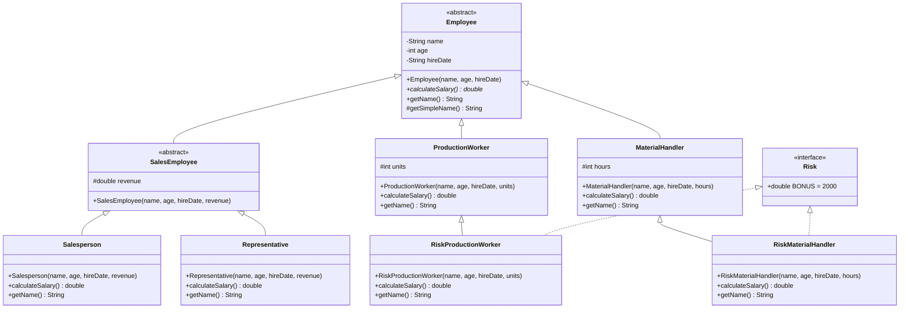

# 🏢 Employee Payroll & Risk Management System (Java OOP)

[]()
[]()
[]()

> An academic project (Advanced Java Lab 1) demonstrating the power of Object-Oriented Programming (OOP) for modeling a payroll system and managing workplace risks.

<div align="center">
  
</div>

---

## 📑 Table of Contents
- [About the Project](#-about-the-project)
- [Key Features](#-key-features)
- [Architecture & UML Diagram](#-architecture--uml-diagram)
- [How It Works](#-how-it-works)
- [🌱 Beginner's Learning Guide](#-beginners-learning-guide)
- [🚀 How to Run](#-how-to-run)

---

## 🎯 About the Project

This project is a complete Java implementation of an employee management system for a large corporation. It puts core OOP concepts into practice, such as **Inheritance**, **Polymorphism**, **Abstract Classes**, and **Interfaces**.

The goal is to automatically calculate the monthly salary of different types of employees (Salespersons, Representatives, Production Workers, Material Handlers) based on specific criteria (revenue, units produced, hours worked) and to integrate a risk bonus for specific hazardous sectors.

---

## ✨ Key Features

- 👥 **Hierarchical Management**: Clear and scalable employee tree structure.
- 💰 **Dynamic Salary Calculation**: Each employee type has its own customized salary calculation formula overriding a common abstract method.
- 🛡️ **Risk Management**: Automatic allocation of a risk bonus (2000 Dhs) via a dedicated Java interface.
- 📦 **Polymorphism in Action**: Use of a single list (`List<Employee>`) to process all employees uniformly.

---

## 📐 Architecture & UML Diagram

The system is modeled to avoid code redundancy by utilizing intermediate abstract classes and interfaces. All naming conventions follow professional English coding standards.



---

## 🛠️ How It Works

The exercise is built on a solid foundation: the abstract class `Employee`, which defines common properties for all staff (`name`, `age`, `hireDate`) and forces every child class to implement the `calculateSalary()` method.

1. **Sales Staff (`Salesperson`, `Representative`)**: They inherit from an intermediate `SalesEmployee` class (which manages the `revenue` variable). Their salary depends on this revenue plus a fixed base.
2. **Operations Staff (`ProductionWorker`, `MaterialHandler`)**: Their salary is strictly based on their physical output (units produced or hours worked).
3. **High-Risk Employees (`RiskProductionWorker`, `RiskMaterialHandler`)**: These are operations staff who implement the `Risk` interface. When calculating their salary, the `BONUS` constant from the interface is automatically added to their base pay using `super.calculateSalary() + BONUS`.

The main program (`Payroll.java`) illustrates the true power of polymorphism: it creates a collection of various employee types and calls `calculateSalary()` on each one. Java dynamically determines at runtime which mathematical formula to apply based on the object's specific instantiated type.

---

## 🌱 Beginner's Learning Guide

If you are new to Java or Object-Oriented Programming, this project is a fantastic sandbox. Here is how you can use it to learn step-by-step:

### Step 1: Understand the Basics (Classes & Objects)

* Read the `Employee` abstract class code. Notice how it "forces" other classes to define a behavior by using `public abstract double calculateSalary();`.

### Step 2: Inheritance (The `extends` keyword)

* Look at the `ProductionWorker` class. It uses `extends Employee`. It inherits the name and age, meaning you don't have to rewrite those variables.
* **Exercise for you:** Add a new class `Developer` that inherits from `Employee`. Give it a fixed monthly salary (e.g., 15000 Dhs).

### Step 3: Interfaces (The `implements` keyword)

* Analyze the `Risk` interface and how `RiskProductionWorker` uses it. Interfaces grant additional "capabilities" or properties to a class without forcing a strict parent-child relationship.
* **Exercise for you:** Create a `SeniorityBonus` interface and implement it for employees with over 10 years of service.

### Step 4: Polymorphism (The final magic)

* Go to the `Payroll` class (the `main` method). Look at how the `for` loop processes the list. The loop doesn't care if the employee is a `Salesperson` or a `MaterialHandler`. It just says, "calculate your salary." That’s polymorphism!

---

## 🚀 How to Run

### Prerequisites

* Java Development Kit (JDK) 8 or higher.
* An IDE (IntelliJ IDEA, Eclipse, VS Code) or terminal.

### Running the Project

1. Clone this repository:
```bash
git clone [https://github.com/Lagmouchyoussef/Employee-Payroll-Risk-Management-System.git](https://github.com/Lagmouchyoussef/Employee-Payroll-Risk-Management-System.git)

```


2. Open the project in your preferred IDE.
3. Run the main class containing the `main` method (`Payroll.java`).

---
