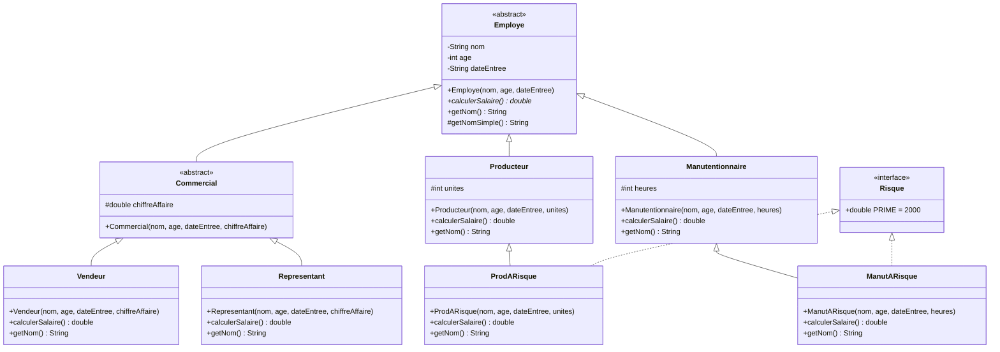

# 🏢 Employee Payroll & Risk Management System (Java OOP)

[](https://www.java.com/)
[](https://en.wikipedia.org/wiki/Unified_Modeling_Language)
[]()

> An academic project (Advanced Java Lab 1) demonstrating the power of Object-Oriented Programming (OOP) for modeling a payroll system and managing workplace risks.

<div align="center">
  
</div>

---

## 📑 Table of Contents
- [About the Project](#-about-the-project)
- [Key Features](#-key-features)
- [Architecture & UML Diagram](#-architecture--uml-diagram)
- [How It Works](#-how-it-works)
- [🌱 Beginner's Learning Guide](#-beginners-learning-guide)
- [🚀 How to Run](#-how-to-run)

---

## 🎯 About the Project

This project is a Java implementation of an employee management system for a large corporation. It puts core OOP concepts into practice, such as **Inheritance**, **Polymorphism**, **Abstract Classes**, and **Interfaces**.

The goal is to automatically calculate the monthly salary of different types of employees (Salespersons, Representatives, Producers, Handlers) based on specific criteria (turnover, units produced, hours worked) and to integrate a risk bonus for specific hazardous sectors.

*(Note: The source code uses French terminology as per the original assignment requirements).*

---

## ✨ Key Features

- 👥 **Hierarchical Management**: Clear and scalable employee tree structure.
- 💰 **Dynamic Salary Calculation**: Each employee type has its own customized salary calculation formula.
- 🛡️ **Risk Management**: Automatic allocation of a risk bonus (2000 Dhs) via a dedicated Java interface.
- 📦 **Polymorphism in Action**: Use of a single list (`List<Employe>`) to process all employees uniformly.

---

## 📐 Architecture & UML Diagram

The system is modeled to avoid code redundancy by utilizing intermediate abstract classes and interfaces.



---

## 🛠️ How It Works

The exercise is built on a solid foundation: the abstract class `Employe`, which defines common properties for all staff (name, age, hiring date) and forces every child class to implement the `calculerSalaire()` method.

1. **Sales Staff (`Vendeur`, `Representant`)**: They inherit from an intermediate `Commercial` class (which manages the `chiffreAffaire` or turnover). Their salary depends on this turnover plus a fixed base.
2. **Operations Staff (`Producteur`, `Manutentionnaire`)**: Their salary is strictly based on their output (units produced or hours worked).
3. **High-Risk Employees (`ProdARisque`, `ManutARisque`)**: These are operations staff who implement the `Risque` interface. When calculating their salary, the `PRIME` constant from the interface is automatically added to their base pay.

The main program (`Salaires.java`) illustrates the true power of polymorphism: it creates a collection of various employee types and calls `calculerSalaire()` on each one. Java dynamically determines at runtime which formula to apply based on the object's specific type.

---

## 🌱 Beginner's Learning Guide

If you are new to Java or Object-Oriented Programming, this project is a fantastic sandbox. Here is how you can use it to learn step-by-step:

### Step 1: Understand the Basics (Classes & Objects)

* Read the `Employe` abstract class code. Notice how it "forces" other classes to define a behavior by using `public abstract double calculerSalaire();`.

### Step 2: Inheritance (The `extends` keyword)

* Look at the `Producteur` class. It uses `extends Employe`. It inherits the name and age, meaning you don't have to rewrite those variables.
* **Exercise for you:** Add a new class `Developpeur` that inherits from `Employe`. Give it a fixed monthly salary (e.g., 15000 Dhs).

### Step 3: Interfaces (The `implements` keyword)

* Analyze the `Risque` interface and how `ProdARisque` uses it. Interfaces grant additional "capabilities" or properties to a class without forcing a strict parent-child relationship.
* **Exercise for you:** Create a `PrimeAnciennete` (Seniority Bonus) interface and implement it for employees with over 10 years of service.

### Step 4: Polymorphism (The final magic)

* Go to the `Salaires` class (the `main` method). Look at how the `for` loop processes the list. The loop doesn't care if the employee is a `Vendeur` or a `Manutentionnaire`. It just says, "calculate your salary." That’s polymorphism!

---

## 🚀 How to Run

### Prerequisites

* Java Development Kit (JDK) 8 or higher.
* An IDE (IntelliJ IDEA, Eclipse, VS Code) or terminal.

### Running the Project

1. Clone this repository:
```bash
git clone [https://github.com/Lagmouchyoussef/Employee-Payroll-Risk-Management-System.git](https://github.com/Lagmouchyoussef/Employee-Payroll-Risk-Management-System.git)

```


2. Open the project in your preferred IDE.
3. Run the main class containing the `main` method (`Salaires.java`).

---
